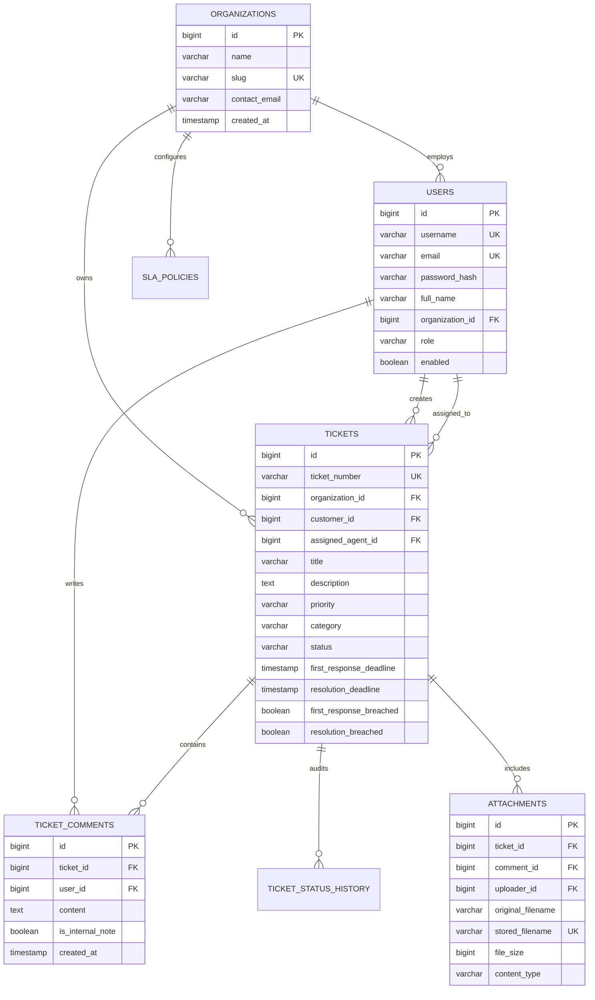

# HelpDesk Pro — Real-Time Multi-Tenant Support Ticket Platform

HelpDesk Pro is an enterprise customer support platform built with **Java 21 LTS**, **Spring Boot 3.3.4**, **PostgreSQL 16**, and **Spring WebSocket (STOMP)**. It demonstrates strict tenant boundary isolation, a deterministic ticket state machine, automated background SLA tracking with scheduled breach detection, private internal staff notes, and real-time event streaming.

---

## 1. Problem Statement
In multi-tenant SaaS environments, security and data isolation are critical:
- Inadequate server-side authorization can cause catastrophic cross-tenant data leaks where Tenant A reads Tenant B's confidential tickets or customer data.
- Arbitrary user-controlled status updates can bypass business validation workflows.
- Internal staff discussions or diagnostic dumps can inadvertently leak to external customers.
- Support agreements (SLAs) with contractual penalties fail without persistent deadline tracking and proactive breach escalations.

HelpDesk Pro addresses these challenges with server-side tenant isolation enforcement, a strict state transition graph, scoped WebSocket message delivery, and an automated background SLA scheduling engine.

---

## 2. Key Features
- **Multi-Tenant Boundary Isolation**: Enforces tenant boundaries at both data access and service layers using authenticated `CustomUserPrincipal` organization IDs. A user from Organization A can never query, update, or assign tickets from Organization B.
- **Deterministic State Machine**:
  ```text
  OPEN -> ASSIGNED -> IN_PROGRESS -> RESOLVED -> CLOSED
            ^             |           |
            |-------------|           v
            |----------------------- REOPEN (OPEN)
  ```
  Transitions are strictly enforced via `canTransitionTo()`. Arbitrary status mutations are rejected with `InvalidStatusTransitionException`.
- **Role-Based Access Control**:
  - `ROLE_PLATFORM_ADMIN`: Global cross-tenant governance and organization management.
  - `ROLE_ORGANIZATION_ADMIN`: Configures tenant-level SLA policies, manages staff and agents.
  - `ROLE_AGENT`: Assigned tickets, advances workflows, posts public comments and private internal notes.
  - `ROLE_CUSTOMER`: Creates tickets, views public responses, and closes/reopens own tickets.
- **Confidential Internal Notes**: Staff members can post private internal comments that are permanently hidden from customer views and excluded from customer WebSocket broadcasts.
- **Scheduled SLA Engine**: Computes first-response and resolution deadlines using organization-specific priority policies. A Spring `@Scheduled` background worker continuously evaluates past-due tickets, flags breach records, and publishes escalation events.
- **Secure File Attachments**: Files are stored with UUID prefixing and validated against path-traversal attacks (`..`, `/`, `\`). Attachments linked to internal notes are protected against unauthorized customer download.
- **Live WebSocket/STOMP Streaming**: Dispatches live updates to tenant-scoped destinations (`/topic/org/{orgId}/tickets`), ticket detail topics (`/topic/tickets/{ticketId}`), and private user queues (`/user/queue/notifications`).

---

## 3. Technology Stack
- **Backend**: Java 21 LTS, Spring Boot 3.3.4, Spring Data JPA / Hibernate, Spring Security 6, Spring WebSocket (STOMP), Spring Scheduling (`@EnableScheduling`), Jakarta Validation.
- **Database**: PostgreSQL 16 (production/Docker), Flyway Database Migrations (`V1__init_schema.sql`, `V2__seed_demo_data.sql`), H2 (PostgreSQL compatibility mode for tests).
- **Frontend**: Server-rendered Thymeleaf, Bootstrap 5, Bootstrap Icons, Vanilla JavaScript, SockJS, STOMP.js.
- **Testing**: JUnit 5, Mockito, Spring Boot Test, Spring Security Test.
- **Containerization**: Multi-stage Dockerfile, Docker Compose.

---

## 4. Architecture Overview

### System Architecture Diagram
```mermaid
flowchart TD
    Client["Browser / REST Client"] -->|HTTPS / WSS| Security["Spring Security (Session / Basic Auth / CSRF)"]
    Security --> SecurityContext["CustomUserPrincipal (Holds OrgID & Role)"]
    SecurityContext --> TicketController["Ticket Controller"]
    
    TicketController --> TicketService["TicketService"]
    
    subgraph ServiceLayer["Service & Multi-Tenant Isolation Layer"]
        TicketService --> TenantCheck{"Tenant Access Check<br/>principal.orgId == ticket.orgId?"}
        TenantCheck -->|No| Reject["403 TenantAccessDeniedException"]
        TenantCheck -->|Yes| StateCheck{"State Machine Check<br/>currentStatus.canTransitionTo(target)?"}
        StateCheck -->|No| Invalid["400 InvalidStatusTransitionException"]
        StateCheck -->|Yes| DB["PostgreSQL 16 (Tickets & Comments)"]
        
        CommentService["CommentService"] --> NoteFilter{"Internal Note Check<br/>isCustomer?"}
        NoteFilter -->|Yes| FilterOut["Filter out internal notes"]
        NoteFilter -->|No| ReturnAll["Return all comments"]
    end
    
    DB --> Commit["Database Commit"]
    Commit -->|TransactionPhase.AFTER_COMMIT| TicketEventListener["TicketEventListener"]
    
    subgraph RealTimeBroker["Spring STOMP Message Broker"]
        TicketEventListener -->|/topic/org/{orgId}/tickets| OrgTopic["Tenant Dashboard Stream"]
        TicketEventListener -->|/topic/tickets/{ticketId}| TicketTopic["Ticket Live Conversation Stream"]
        TicketEventListener -->|/user/{username}/queue/notifications| UserQueue["Private User Notification"]
    end
    
    subgraph ScheduledEngine["Automated SLA Engine"]
        SlaScheduler["@Scheduled(fixedRate = 60000)"] --> SlaScan["Scan Overdue Deadlines"]
        SlaScan --> SlaBreach["Mark Breached & Publish Escalation Event"]
    end
```

### Entity-Relationship (ER) Diagram


---

## 5. Multi-Tenant Security & State Machine Rules
### Server-Side Tenant Verification
Client-supplied organization IDs are **never trusted**:
```java
public void verifyTenantAccess(Ticket ticket, CustomUserPrincipal principal) {
    if (principal.isPlatformAdmin()) return;
    if (principal.getOrganizationId() == null || !principal.getOrganizationId().equals(ticket.getOrganization().getId())) {
        throw new TenantAccessDeniedException("Access Denied: Ticket belongs to a different organization.");
    }
}
```

### State Machine Transition Validation
```java
public enum TicketStatus {
    OPEN, ASSIGNED, IN_PROGRESS, RESOLVED, CLOSED;

    public boolean canTransitionTo(TicketStatus target) {
        Set<TicketStatus> allowed = VALID_TRANSITIONS.get(this);
        return allowed != null && allowed.contains(target);
    }
}
```

---

## 6. REST API Reference

| Method | Endpoint | Description | Permitted Roles |
|---|---|---|---|
| `GET` | `/api/v1/tickets` | List organization tickets (paginated, filterable) | All Authenticated |
| `POST` | `/api/v1/tickets` | File new support ticket | `ROLE_CUSTOMER` |
| `GET` | `/api/v1/tickets/{id}` | Retrieve ticket details | Organization Members |
| `PATCH` | `/api/v1/tickets/{id}/status` | Transition ticket status | Organization Members |
| `GET` | `/api/v1/tickets/{id}/comments` | Retrieve ticket conversation | Organization Members |
| `POST` | `/api/v1/tickets/{id}/comments` | Post comment / internal note | Organization Members |

---

## 7. Demo Credentials & Running Locally

### Demo Credentials
- **Acme Corp Customer**: Username: `acme_customer` | Password: `Customer@123` (Tenant 1)
- **Acme Corp Agent**: Username: `acme_agent` | Password: `Agent@123` (Tenant 1)
- **Acme Corp Admin**: Username: `acme_admin` | Password: `Admin@123` (Tenant 1)
- **Starlight Customer**: Username: `star_customer` | Password: `Customer@123` (Tenant 2)
- **Starlight Admin**: Username: `star_admin` | Password: `Admin@123` (Tenant 2)
- **Platform Super Admin**: Username: `superadmin` | Password: `Super@123` (Global)

### Run with Maven Locally
```bash
cd portfolio-java-projects/helpdesk-pro
mvn spring-boot:run
```
Access at `http://localhost:8081`.

### Run with Docker Compose
```bash
cd portfolio-java-projects/helpdesk-pro
docker compose up --build -d
```

### Run Tests
```bash
cd portfolio-java-projects/helpdesk-pro
mvn clean test
```

---

## 8. Interview Readiness & Resume Highlights

### Resume Bullets
- Built **HelpDesk Pro**, a multi-tenant customer support platform in **Java 21** and **Spring Boot 3.3**, enforcing strict organizational data isolation across database queries, service transactions, and file downloads.
- Implemented a state machine for ticket workflows (`OPEN` &rarr; `ASSIGNED` &rarr; `IN_PROGRESS` &rarr; `RESOLVED` &rarr; `CLOSED`), rejecting invalid status updates and safeguarding internal staff notes from customer visibility.
- Engineered an automated SLA tracking engine with Spring Scheduling (`@Scheduled`), calculating priority-driven targets, flagging breached deadlines, and broadcasting real-time alerts via **Spring WebSocket (STOMP)**.

### Key Engineering Decisions
1. **Server-Side Tenant Context**: User organization IDs are loaded directly from the authenticated session principal, preventing client manipulation of tenant identifiers.
2. **Internal Note Filtering**: Filtered at the service layer rather than hidden purely via frontend CSS, preventing security leaks via direct API inspection.
3. **Dedicated Status Transition Graph**: State validation encoded inside enum `canTransitionTo()`, making workflow rules testable in pure isolation.
4. **Path-Traversal Protected Local Storage**: Cleaned and validated filenames prevent directory traversal attacks on attachment uploads.
5. **Scheduled SLA Monitoring**: Periodic database polling flags overdue tickets consistently without relying on client-side browser timers.
